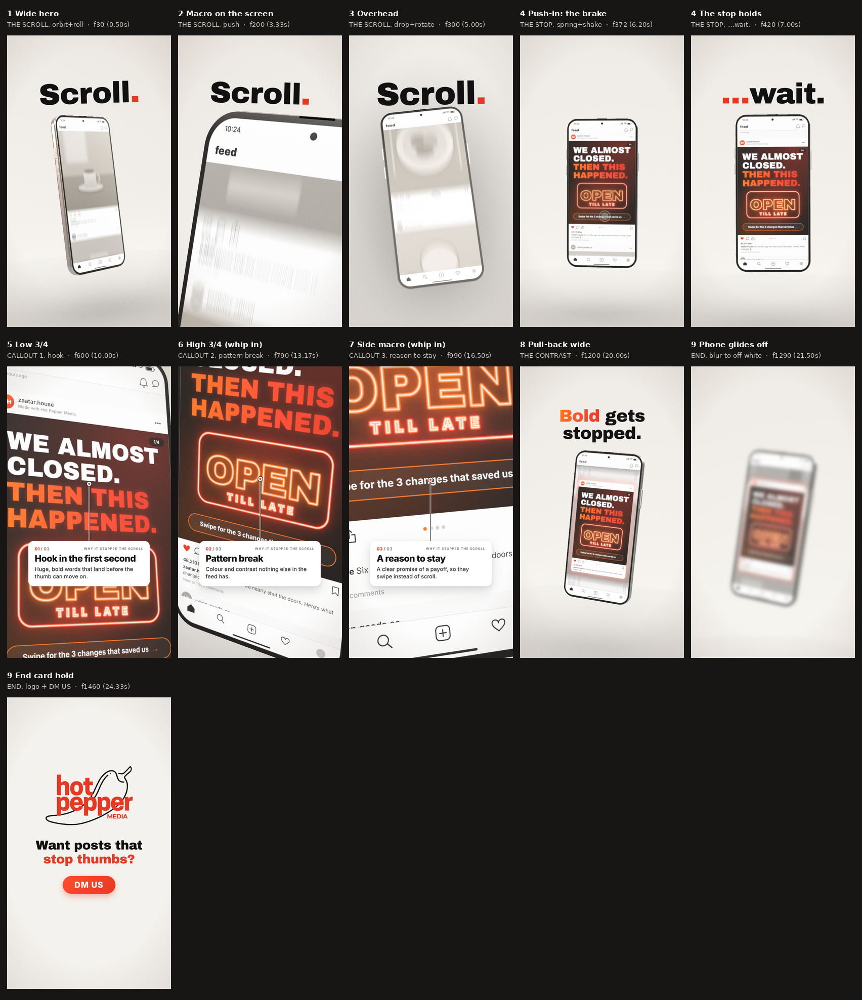

# Hot Pepper Media: "The Scroll Test"

A 25-second vertical reel (1080×1920, 60fps, 1500 frames) built in Remotion with `@remotion/three` (React Three Fiber) and `@remotion/motion-blur`. It's styled as a filmed product ad. A 3D phone floats in an off-white studio while a feed of bland grey posts races past. Then a post made by Hot Pepper Media appears, the scroll slams to a stop, and three callouts break down why it stopped the scroll. The reel ends on "Want posts that stop thumbs?" and a "DM US" button.

The hero post is for a **fictional** restaurant, Zaatar House. Every account and post in the feed is fictional, and the phone and the feed app are generic and unbranded. There are no photos and no real people.



```
npm install
npm run studio                     # preview and scrub in the browser
npm run stills                     # QA stills → out/stills (or: npm run stills -- out/safe 0.5 300,600 --safe)
npm run preview                    # half-res draft → out/preview.mp4
npm run render                     # final with sound → out/hotpepper-scroll-test.mp4 (H.264, CRF 16, yuv420p, preset slow)
npm run render:silent              # same, no audio track → out/hotpepper-scroll-test-silent.mp4
npm run sfx:wav                    # the sound effects alone → out/hotpepper-scroll-test-sfx.wav
npm run audio:wav                  # effects + voiceover → out/hotpepper-scroll-test-audio.wav
npm run cover                      # 1080×1920 PNG cover from the stop's hold → out/hotpepper-scroll-test-cover.png
npm run check:camera               # camera path jerk report
npm run check:frames               # scan the final video for flicker / black / glitched frames
npm run sfx:make                   # regenerate the effect sounds in public/sfx (needs numpy)
```

### Rendering

Rendering uses SwiftShader through ANGLE (`swangle`, set in `remotion.config.ts`), so it needs no GPU and every frame is deterministic. To use a Chrome Headless Shell you already have, set `REMOTION_BROWSER=/path/to/chrome-headless-shell`. Fonts load through `@remotion/google-fonts`: Archivo Black (display), Inter (small text) and Noto Color Emoji. Stay online while rendering.

On a 4-core machine without a GPU, the final render takes about 70–80 minutes and the half-res preview about 25. For a quick look, pass `--props='{"draft":true}'`. That renders one sample per frame, with no motion blur and no anti-aliasing.

Keep the CRF, x264 preset and pixel format on the render command (as in `package.json`), not in `remotion.config.ts`. Putting them in the config breaks the WAV renders.

## Changing things

Everything you are likely to change is in **`src/data.ts`**.

- **Copy:** `COPY` holds the kinetic words ("Scroll." ×3, "…wait.", the two contrast lines), the end line and the CTA. `CALLOUTS` holds the three cards' titles and body text.
- **The hero post:** `HERO_POST` holds the handle, the "Made with Hot Pepper Media" subtitle, the headline (white lines and the hot gradient lines), the neon sign words, the promise pill, the likes and the caption.
  - The post is drawn in `drawHeroPost()` in `src/three/feedTextures.ts`. `HERO_LAYOUT` there sets where the headline, the neon sign and the promise pill sit. The callouts point at those three positions automatically.
  - The headline auto-fits the post's width.
- **The bland feed:** `BLAND_POSTS` holds the handles, captions and likes. `scene` picks one of eight grey, stock-photo-like images (drawn in `blandScene()`).
- **Colours:**
  - `BRAND`: red `#E63922`, orange `#FF7A1A` and glow `#FF4D2E` (accents only), off-white `#F4F2EE`, charcoal, and the card colours (ink `#111`, text `#333`, meta `#777`).
  - `FEED_COLORS`: the feed app's UI and the hero's dark background.
- **Timings:** `T`, in frames at 60fps.
  - The scroll words (`scrollWordAt`), the stop (`brake`, `waitAt`) and the callouts (`calloutAt`, `calloutHold`).
  - The contrast (`pullBack`, `heroLift`, `feedResume`, `contrast1At`, `contrast2At`) and the end card (`endStart`, `phoneOff`, `logoAt`, `endLineAt`, `ctaAt`, `holdFrom`).
  - `coverFrame` is the frame used for the cover PNG.
- **The scroll:**
  - `SCROLL.flicks` holds the thumb flicks. They come closer together towards the stop, so the scroll speeds up. `speedFrom`/`speedTo` set the base speed.
  - The brake is a damped spring (`brakeOmega`, `brakeDamping`) tuned so the hero overshoots its resting place by `overshoot` px and settles.
- **Shots:** `SHOTS` holds nine shots. Each has a start and end frame and camera keyframes `from` → `to`:
  - `focus`: a point on the screen in screen px, or the phone's centre.
  - `yaw`, `pitch`, `dist`, `fov`, `roll`, and `frameY` (where the focus lands on the frame).
  - An easing (`out` is a speed ramp: fast, then settling), and the phone's own pose.
  - `whipIn` turns the cut into a whip pan of that many frames.
- **Look:** `LOOK` sets the shutter (0.5 = 180°), the grain and the vignette.
- **Voiceover:** `VOICEOVER` holds the three lines and their start frames. Set `lines: []` for none.

If you retime things, keep each callout inside its shot, and keep the hold free of motion after `T.holdFrom`. Re-run `npm run check:camera` after editing `SHOTS`.

## How it's built

- **Renderer** (`src/three/Renderer.tsx`): real motion blur in a single WebGL context.
  - Every frame renders 4–12 sub-frame samples across a 180° shutter into a half-float buffer, and averages them.
  - Each sample re-poses the camera, the phone, the scroll and the touch indicator from pure functions of time. The sample count rises with on-screen motion.
  - Each sample also gets a sub-pixel jitter, so the averaging doubles as anti-aliasing.
  - Moving samples get a short directional blur along an affine motion field (translation, zoom, roll) fitted to the phone. This closes the gaps between samples on whips and the dolly.
  - Still moments put every sample at the same instant, so they stay crisp.
  - Samples never cross a hard cut.
  - A final pass applies a soft-knee tone curve and a warm grade.
  - There is no `useFrame` anywhere: everything comes from `useCurrentFrame()`.
- **Timing functions** (`src/lib/`):
  - `scroll.ts`: the feed's position, the brake spring and the thumb.
  - `shots.ts`: the camera, the phone pose, the impact shake, the zoom punch and the phone's physical jolt.
  - `look.ts`: the desaturation, the neon flicker and the impact frame.
- **Phone** (`src/three/world.ts`):
  - An original, unbranded design: a rounded extruded body with merged smooth normals, in satin aluminium (PBR). It has side buttons, antenna lines and an earpiece slit.
  - Reflections come from three.js `RoomEnvironment` through PMREM: procedural, no HDRI. There is a warm key light and two rim lights.
  - The front glass is one shader: the black bezel, the rounded screen with its punch-hole camera, and a Fresnel reflection of an analytic studio with soft boxes.
- **Screen** (`src/three/feedTextures.ts`, `src/three/shaders.ts`): high-resolution CanvasTextures with mipmaps and anisotropic filtering, so text stays razor-sharp.
  - The textures are a 2048×6800 atlas of eight bland posts, the 2048×1700 hero (neon off | neon on) and the 1024×2224 app chrome.
  - The shader composites the scrolling feed. It motion-blurs the scroll along its velocity over each sample's slice of the shutter.
  - After the stop, it drains the colour from everything but the hero. In the contrast, it lifts the hero off the feed as a glowing card.
- **Studio:** an unlit off-white cyclorama, so the brand off-white stays exact. It has a soft light falloff and a contact shadow: analytic ambient occlusion from a grid of spheres that follows the phone.
- **Overlays** (`src/ui/`): HTML, so text is crisp.
  - The kinetic type (`Type.tsx`) slams in on springs. Its motion blur comes from `CameraMotionBlur`, only while it moves.
  - The callout cards (`Callouts.tsx`) have leader lines that are re-projected from the 3D post every frame.
  - The end card (`EndCard.tsx`) uses the traced logo from `hpm-maps-remotion` (`src/lib/logoTrace.ts`, `src/ui/Logo.tsx`).
  - The finish (`Finish.tsx`) is a warm vignette and a subtle film grain (`scripts/make-grain.py`).

## Sound

Every effect is synthesised from sine waves and filtered noise by `scripts/make-sfx.py` into `public/sfx/`. They are original, license-free and identical on every run. `src/sound.tsx` places them, and every cue comes from the same timings as the visuals. The effects are kept soft, so they sit under the music you add in Instagram.

| Moment | Sound |
|---|---|
| The scroll | a papery swish per thumb flick, climbing in pitch as the flicks speed up, over an airy rush whose level follows the scroll speed |
| "Scroll." words | a soft thump |
| The stop | a fast friction brake into a heavy thud (the rush cuts dead), then neon ticks as the sign flickers on |
| "…wait." | a soft low tick |
| Callouts | a pop per card, a step higher each time, and a tiny tick as each leader line lands |
| Whips | a short whip whoosh |
| Pull-back | a wide whoosh; a warm shimmer as the hero lifts off |
| Contrast lines | a dull thump for "Bland", a bright one for "Bold" |
| End card | a swoosh as the phone glides off, a warm whomp for the logo, a tap for "DM US" |

- **Overall level:** `SFX_MASTER` in `src/sound.tsx`. Each cue has its own volume in `getCues()`.
- **Adding sound to a silent render:**
  `ffmpeg -i out/hotpepper-scroll-test-silent.mp4 -i out/hotpepper-scroll-test-audio.wav -map 0:v -map 1:a -c:v copy -c:a aac -b:a 320k -shortest out/with-sound.mp4`

## Voiceover

Three short lines:

- "Scroll… scroll…" under the last "Scroll." beat
- "Wait." on the stop
- "Your turn." with the "DM US" button

The effects dip under the voice (`VOICEOVER.duckTo`).

- **Voice:** Supertonic 3 by Supertone (licence OpenRAIL-M, which allows commercial use), run locally through sherpa-onnx, voice 3.
- **Regenerating** (after changing the text, also update `LINES` in the script):
  ```
  pip install sherpa-onnx soundfile librosa numpy
  # unpack into MODELS_DIR from github.com/k2-fsa/sherpa-onnx/releases:
  #   tts-models/sherpa-onnx-supertonic-3-tts-int8-2026-05-11.tar.bz2
  #   asr-models/sherpa-onnx-whisper-small.en.tar.bz2
  python3 scripts/make-voiceover.py MODELS_DIR 3      # → public/vo/*.wav and src/voLengths.ts
  ```
  The script renders a few takes of each line and has Whisper check every word. It keeps the liveliest take, gives it a light polish, and levels it.

## Layout and safe zones

Instagram covers the top 220 px, the bottom 400 px and the right 140 px. Everything sits in one centred column, x 140–940, with equal 140 px margins.

- **Kinetic type:** a band centred on y 384 (about 250–520), above the phone.
- **Callout cards:** start at y 1150 and end above y 1520. The leader lines point up to the post.
- **End card:** the logo, the line and the CTA sit between y 440 and about 1300.

`npm run stills -- out/safe 0.5 <frames> --safe` draws the zones and the column on top of the stills.

## Quality checks

- `npm run check:camera` reports the largest second differences of the camera path. Hard cuts are skipped; the whips are intentional.
- `npm run check:frames` flags dark frames, black patches (the signature of NaN pixels), single-frame flicker and big jumps that aren't planned cuts.
- `scripts/storyboard.py` builds the labelled storyboard sheet in `docs/`.
